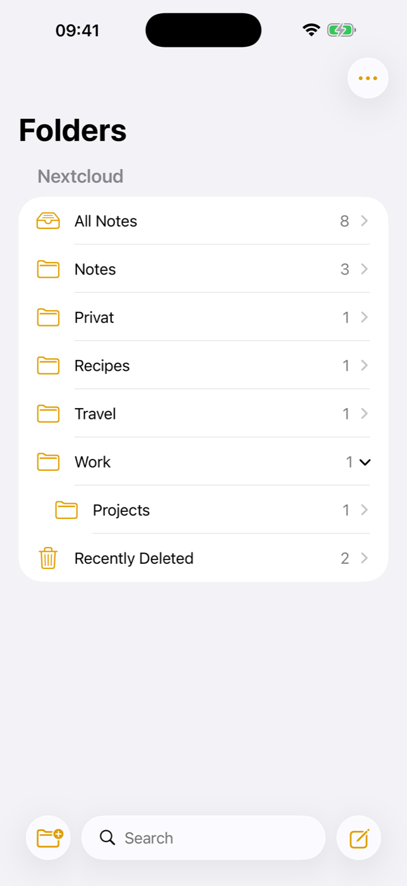
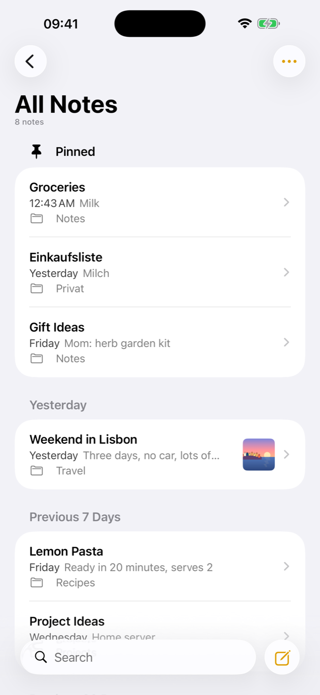
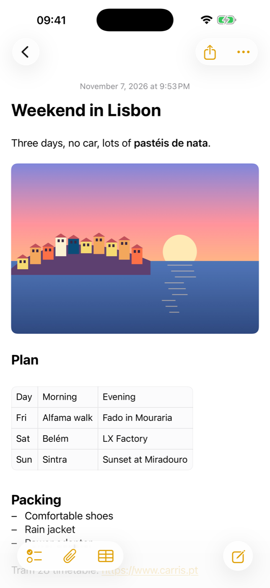
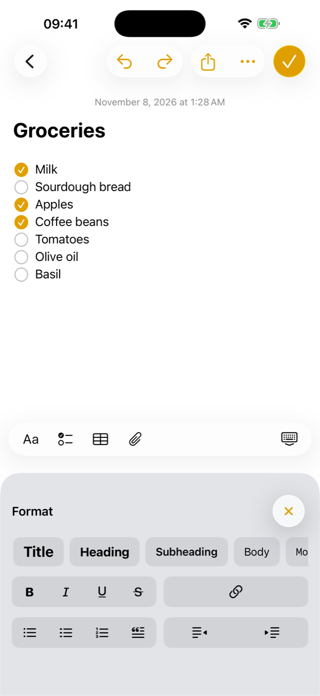
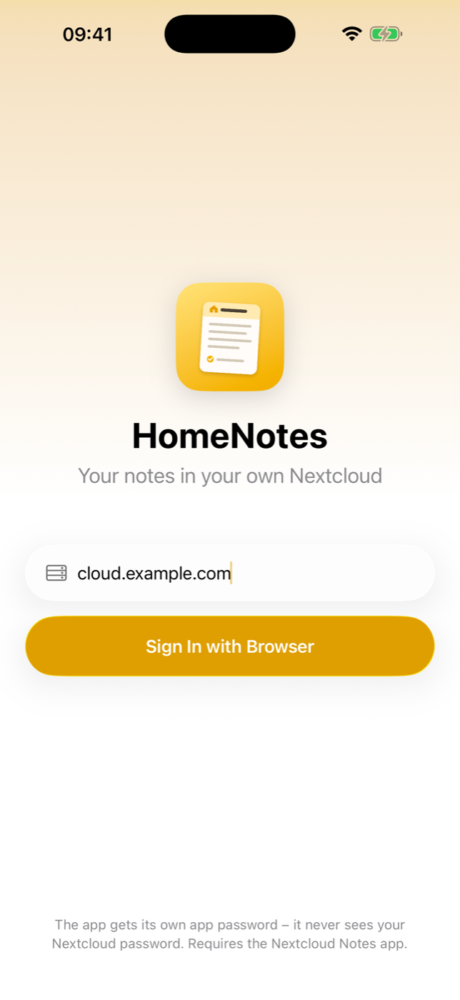

# HomeNotes

**A native iOS notes app for your own [Nextcloud](https://nextcloud.com) – the look and feel of the iPhone Notes app, without iCloud.**

HomeNotes is an independent iPhone client for the Nextcloud [Notes](https://github.com/nextcloud/notes) app. It aims to feel like Apple's Notes app on iOS 26 (folders, pinned notes, swipe actions, checklists, tables, formatting bar …) while every note is a plain Markdown file on a server you own.

> **Status:** first release, tested against Nextcloud 33 with Notes 6.1 (API 1.4). UI in **English and German** (follows the iPhone language). Code comments are in German.
>
> Built with help from [Claude Code](https://claude.com/claude-code): Apple's Notes frameworks were analysed by name and strings only (no decompiling), the Swift was written together with it.
>
> **Personal project:** no guarantees, no support promises. Bug reports and pull requests are welcome, but I answer when I have time.
>
> Not affiliated with Apple or with Nextcloud GmbH. "Nextcloud" is a trademark of its owners.
>
> Part of the HomeRoll family – see also [HomeRoll](https://github.com/silentprovider423/HomeRoll) (photos on your own Immich server).

<p align="center">
  
  
  
  
  
</p>
<p align="center"><sub>Screenshots with demo notes in a test account.</sub></p>

## Features

**Folders**
- All Notes, Notes (no folder), your own folders with **subfolders** (collapsible), note counts
- New folder, new subfolder, rename and delete (WebDAV, so empty folders work too)
- **Recently Deleted** on the device: deleted notes stay 30 days, recover (attachments are re-uploaded) or delete permanently

**Note list**
- Pinned section on top (pinned = Nextcloud favorite), grouped by date: Today, Yesterday, Previous 7 / 30 Days, months, years
- Sort by date edited, date created (read via WebDAV) or title, newest/oldest first, grouping on/off
- Swipe right to pin, swipe left to delete, move or share; long press for a preview with the same actions
- Select several notes to move or delete them at once
- Row with title, date, first line of text, folder and image thumbnail – like Apple

**Search**
- Local full-text index over all notes (case and accent insensitive, prefix search), top hits, per-folder search

**Editor**
- First line is the title; date on top (tap to see the creation date)
- Format panel "Aa" in place of the keyboard: Title, Heading, Subheading, Body, Monostyled; bold, italic, underline, strikethrough; bulleted, dashed and numbered lists, block quote, indent/outdent
- **Checklists** with tappable circles, Return continues the list, empty item ends it; check all, uncheck all, move checked to bottom, delete checked
- **Tables** (shown inline, edited in a table editor: add/delete rows and columns, swap rows, convert to text, delete)
- Links (add/edit/remove), bare URLs become links
- **Attachments** via the Notes attachment API: photos and videos (library or camera), any file; images shown inline, Quick Look, delete
- Undo/redo, find in note, Writing Tools, spell checking, keyboard shortcuts (⌘B/I/U, ⇧⌘T/H/J/B/M, ⇧⌘7/8/9, ⇧⌘L, ⇧⌘U, ⌘K, Tab)
- Paste as Markdown, share a copy, export as `.md`

**Markdown mapping** (what ends up in the file on the server)

| In the app | In the file |
|---|---|
| Title / Heading / Subheading | `#` / `##` / `###` |
| Monostyled | fenced code block |
| Bold, italic, strikethrough, underline | `**…**`, `*…*`, `~~…~~`, `<u>…</u>` |
| Bulleted / dashed / numbered list, indent | `* `, `- `, `1. `, two spaces per level |
| Checklist | `- [ ] ` / `- [x] ` |
| Block quote | `> ` |
| Table | GFM table |
| Image / file | `` / `[name](…)` |

The mapping is line-preserving: every line of the file is one paragraph in the editor, and Markdown the editor doesn't understand stays as text – so opening and saving a note doesn't rewrite it.

**Sync**
- Offline cache with the whole library on the device; changes are saved locally first and uploaded in the background
- Every save uses `If-Match`; on **412** the app merges line by line (3-way) and only if both sides changed the same line it keeps the server version and saves yours as a "(Conflict)" copy – nothing is lost
- Efficient refresh with `pruneBefore`, chunked loading for large libraries, attachments queued while offline

## Requirements

- A Nextcloud server with the **Notes** app (tested with Nextcloud 33 / Notes 6.1; attachments need Notes 4.12.3+, deleting attachments Notes 6.1+), reachable from the iPhone – at home, via VPN or public with HTTPS
- Xcode 26, [XcodeGen](https://github.com/yonaskolb/XcodeGen) (`brew install xcodegen`)
- iPhone with iOS 26

## Install without a Mac

You need your own Nextcloud for this. **Step-by-step guide from zero (server with Docker, Notes app, access from outside, install): [docs/SETUP.md](docs/SETUP.md).**

1. Download `HomeNotes-<version>.ipa` from the latest release.
2. Install it with [SideStore](https://sidestore.io) or [AltStore](https://altstore.io). A free Apple ID is enough, the app then has to be refreshed every 7 days (SideStore does that on the phone).
3. Open the app, enter your Nextcloud address and tap **Sign In with Browser**. Log in on your Nextcloud page (two-factor works too) – the app receives its own app password.

## Build & install

```bash
git clone https://github.com/<you>/homenotes.git
cd homenotes
xcodegen generate
open HomeNotes.xcodeproj
```

1. Set your own **bundle identifier** in `project.yml` (default `org.homeroll.notes`) and select your team in Xcode.
2. Run on your iPhone and sign in with your Nextcloud address.
3. Unsigned IPA for sideloading (AltStore/SideStore): `./build-ipa.sh`.

### Simulator with a test account

Never use your real account for tests. Create a test user on your Nextcloud and put its credentials into a git-ignored file:

```bash
cat > .test-account <<'X'
NOTES_SERVER=https://cloud.example.com
NOTES_USER=notestest
NOTES_PASSWORD=<app password of the test user>
X
xcrun simctl create "HomeNotes Test" "iPhone 17 Pro Max" > .sim-udid
./sim-run.sh                      # build, install, start signed in (debug builds only)
```

Tests (unit tests, live tests against the test account, UI test):

```bash
set -a; . ./.test-account; set +a
TEST_RUNNER_NOTES_SERVER=$NOTES_SERVER TEST_RUNNER_NOTES_USER=$NOTES_USER TEST_RUNNER_NOTES_PASSWORD=$NOTES_PASSWORD \
  xcodebuild -project HomeNotes.xcodeproj -scheme HomeNotes -destination "id=$(cat .sim-udid)" test
```

The live tests create everything in their own `HomeNotesTest-…` folder and delete it again.

## Privacy

- The app talks **only** to your Nextcloud server (Notes API, WebDAV and OCS on the same server).
- No analytics, no third-party SDKs, no other servers.
- Sign-in with Nextcloud Login Flow v2: the app never sees your password, only an app password that you can revoke in Nextcloud (Settings → Security → Devices & sessions). Signing out revokes it.
- App password in the Keychain; the note cache stays in the app's container with iOS file protection.

## Project layout

```
App/API/      Nextcloud Notes API v1, WebDAV, OCS, Login Flow v2
App/Core/     Markdown ⇄ paragraphs, 3-way merge, search index, NoteStore (cache + sync)
App/Editor/   UITextView (TextKit 2) editor, format panel, tables, attachments
App/UI/       folders, note list, login, settings
Tests/        unit tests, live tests against a test account, UI test
tools/        icon generator, string catalog builder
```

## License

[GPL-3.0](LICENSE) (GNU General Public License v3.0; releases up to this change were published under MIT). Nextcloud and the Notes app (AGPL-3.0) are not included – HomeNotes only talks to their HTTP APIs.

---

<!-- home-apps:start -->
## More Home apps

Same idea, other Apple apps – all free, open source and self-hosted:

- **[HomeRoll](https://github.com/silentprovider423/HomeRoll)** – Photos · Immich
- **[HomeRoll Desktop](https://github.com/silentprovider423/HomeRoll-Desk)** – Photos for Mac · Immich
- **[HomeRoll TV](https://github.com/silentprovider423/HomeRoll-TV)** – Photos for Apple TV · Immich
- **[HomeTune](https://github.com/silentprovider423/HomeTune)** – Music · Navidrome
- **[HomePost](https://github.com/silentprovider423/HomePost)** – Mail · IMAP/SMTP or JMAP
- **[HomeFind](https://github.com/silentprovider423/HomeFind)** – Find My · Dawarich
- **[HomeCast](https://github.com/silentprovider423/HomeCast)** – Podcasts · PinePods
- **[HomeThread](https://github.com/silentprovider423/HomeThread)** – notes to self · own server (Docker)

All apps: [github.com/silentprovider423](https://github.com/silentprovider423)
<!-- home-apps:end -->

## Deutsch

**HomeNotes** ist eine eigene iPhone-Notizen-App für deine selbst betriebene Nextcloud (App „Notes“). Sie sieht aus und fühlt sich an wie Apples Notizen unter iOS 26 – Ordner, Angepinnt, Wischgesten, Checklisten, Tabellen, Formatleiste –, aber jede Notiz ist eine Markdown-Datei auf deinem eigenen Server, ohne iCloud. Die Oberfläche gibt es auf Deutsch und Englisch, je nach Sprache des iPhones. Funktionen, Voraussetzungen und Installation stehen oben.
